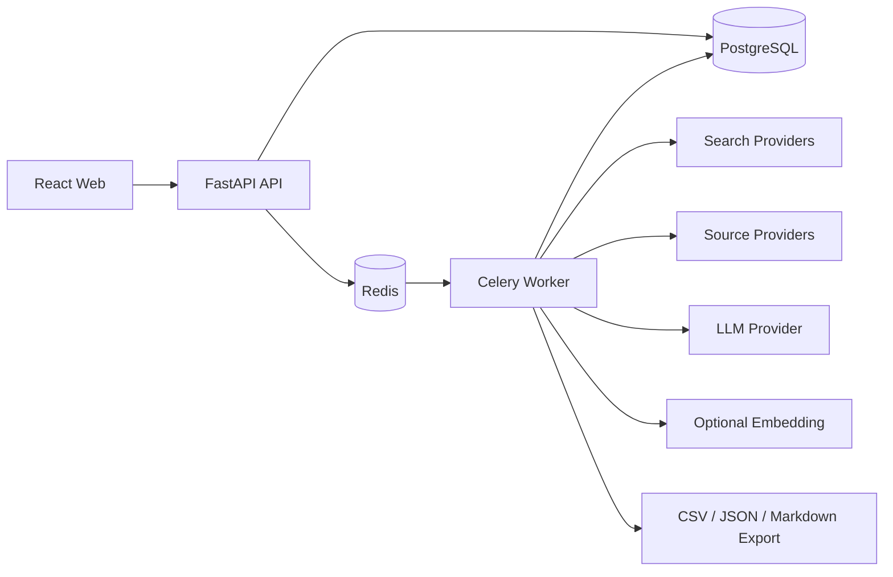

# Industry Pain Radar

证据驱动的行业痛点研究工作台。系统从合法可访问的公开来源检索真实讨论，保存原始链接与证据片段，提取候选痛点，执行可解释的双评分、去重、聚类和人工核验，最终导出可追溯的研究报告。

项目不是“AI 创业点子生成器”。没有原始来源和可校验片段的结论只能作为假设，不能显示为已验证事实。

## 当前状态

当前交付到 Phase 1 本地离线证据闭环。以下能力已实现并通过测试：

- FastAPI + SQLAlchemy + Alembic 后端，研究任务、来源池、痛点、证据、评分、复核、合并和导出均有持久化实现。
- Mock Search 与 Mock LLM 离线路径：创建任务后可完成“搜索 → 来源 → 候选 → 引用校验 → 独立评分 → 人工复核 → 导出”。
- React 19 + TypeScript + Vite 工作台：任务、痛点、证据详情、来源、复核、合并、批注和报告导出。
- OpenAPI 快照与生成类型：`frontend/openapi.json`、`frontend/src/api/schema.d.ts`。
- Docker Compose 本地栈：`api`、`worker`、`postgres`、`redis`、`web` 五个服务已实际启动；迁移、健康检查、Celery 消费、Nginx 代理、安全响应头和非 root 后端进程均已验证，端口仅绑定回环地址。
- 安全基线：SSRF 校验、重定向逐跳校验、对端 IP 失败关闭、引用确定性校验、独立评分、CSV 公式中和、前端外链校验和 CSP。
- 依赖安全：在线 npm 审计为 0 漏洞；`vitest` 已升级到 4.1.12，并显式声明 Testing Library 的 DOM peer 依赖。
- 安全审查与威胁模型：`docs/security-best-practices-report.md`、`demand_search-threat-model.md`。

仍明确未完成或未验证：

- 真实搜索、论坛、GitHub、Reddit 和真实 LLM Provider 默认禁用，尚未做条款/robots 预检。
- API 没有认证和多用户授权；当前只适用于本地单用户，不能暴露到局域网或公网。
- 保留期字段已写入，但尚无自动删除/匿名化任务。

设计与治理文档：

- 需求规范：`行业痛点Codex工程需求规范.md`
- 技术选型与架构决策：[`docs/technical-selection.md`](docs/technical-selection.md)
- 需求分析与实施边界：[`docs/requirements-analysis.md`](docs/requirements-analysis.md)
- 系统架构与数据流：[`docs/architecture.md`](docs/architecture.md)
- 证据、来源与安全规则：[`docs/evidence-and-security.md`](docs/evidence-and-security.md)
- Docker 运行验证记录：[`docs/runtime-verification.md`](docs/runtime-verification.md)
- 工程编码规范：[`AGENTS.md`](AGENTS.md)
- 项目知识图谱：[`docs/knowledge-graph/README.md`](docs/knowledge-graph/README.md)
- 已安装 Codex 技能：`playwright`、`security-best-practices`、`security-threat-model`

## 本地启动

后端（SQLite、内联任务、无 Redis）：

```powershell
cd backend
$env:DATABASE_URL='sqlite+pysqlite:///./.local/dev.db'
$env:REDIS_URL=''
$env:TASK_EXECUTION_MODE='inline'
..\.venv\Scripts\alembic.exe upgrade head
..\.venv\Scripts\python.exe -m uvicorn app.main:app --host 127.0.0.1 --port 8000
```

前端（另一个终端）：

```powershell
cd frontend
$env:NODE_OPTIONS='--preserve-symlinks-main'
npm ci --cache .npm-cache
npm run dev -- --host 127.0.0.1
```

打开 `http://127.0.0.1:5173`，点击“运行离线演示”。API 文档在开发模式下位于 `http://127.0.0.1:8000/docs`。

## 验证命令

```powershell
.\.venv\Scripts\python.exe scripts\smoke_demo.py
.\.venv\Scripts\python.exe scripts\export_openapi.py --check

cd backend
..\.venv\Scripts\ruff.exe check .
..\.venv\Scripts\ruff.exe format --check .
..\.venv\Scripts\mypy.exe app
..\.venv\Scripts\pytest.exe

cd ..\frontend
$env:NODE_OPTIONS='--preserve-symlinks-main'
npm run lint
npm run typecheck
npm run test
npm audit --json
npm run build
```

更新 API 快照和类型：

```powershell
.\.venv\Scripts\python.exe scripts\export_openapi.py
cd frontend
npm run api:types
```

Compose（先启动 Docker Desktop）：

```powershell
docker compose up --build -d
docker compose ps
```

本地 Compose 端口为 `127.0.0.1:8080`（Web）和 `127.0.0.1:8000`（API）。2026-10-22 已实际执行构建与启动：五个服务健康，Alembic 迁移成功，Celery Worker 消费了离线任务，Nginx 的健康检查、OpenAPI 代理与安全响应头通过验证。完整命令、计数和浏览器结果见 `docs/runtime-verification.md`。停止栈使用 `docker compose down`。

## 安全边界

- 手动 URL 导入只允许 HTTP(S)，并校验端口、主机、IP 字面量、DNS、每一跳重定向、对端地址、内容类型、响应大小和超时。
- 页面文本和搜索摘要都是不可信数据；模型不能提供权威 URL、来源 ID、作者、时间或评分。
- 只有存在持久化证据、合法 HTTP(S) 来源和精确/规范化引用命中时，人工核验才能把痛点标记为 `verified`。
- 证据置信度、商业机会和覆盖度始终分开保存与展示，不合并为单一总分。
- 所有列表接口服务端分页；导出保留来源链接、引用、采集时间和评分版本。
- 当前无认证，只能本机使用。任何网络暴露前必须先增加认证、授权和 TLS。

## 技术基线

| 层 | 选型 |
|---|---|
| 后端 | Python 3.12、FastAPI、Pydantic v2、SQLAlchemy 2.x、Alembic |
| 数据 | PostgreSQL 16、Redis |
| 异步任务 | Celery（单个队列方案） |
| 前端 | React、TypeScript、Vite、Tailwind CSS、shadcn/ui |
| 前端数据与表单 | TanStack Query、React Router、React Hook Form、Zod |
| 测试 | pytest、httpx TestClient、Vitest、Testing Library、Playwright |
| 质量 | Ruff、mypy、ESLint、Prettier、TypeScript strict |
| 部署 | Docker Compose 本地模块化单体 |
| LLM / Embedding | Provider 抽象；Mock 默认，OpenAI-compatible 可选，Embedding 可关闭 |

具体边界、替代方案和理由见技术选型文档。

## 架构概览



研究任务的状态、进度和证据以 PostgreSQL 为准；Redis 只承担消息传递和短期任务结果，不作为业务事实来源。

## 知识图谱优先

知识图谱的可编辑源文件是 `docs/knowledge-graph/project-graph.json`。它覆盖需求、技术决策、运行组件、数据实体、安全控制、交付阶段、验收项、技能和操作事件。

每次修改代码、架构、依赖、安全策略或交付状态时，必须同步添图谱节点/边和一条事件记录。校验与渲染命令：

```powershell
python scripts/validate_knowledge_graph.py
python scripts/render_knowledge_graph.py
python scripts/render_knowledge_graph.py --check
```

生成的 `docs/knowledge-graph/project-graph.mmd` 可被 GitHub、Mermaid CLI 或支持 Mermaid 的编辑器渲染。

## 首期交付原则

1. 先完成无外部密钥可运行的 Mock 闭环，再接入真实 Provider。
2. 先写数据约束、证据校验和迁移，再写抽取与评分逻辑。
3. 来源可追溯优先于模型效果；确定性规则优先于 Prompt 自由判断。
4. 每个阶段必须通过格式检查、静态检查、单元测试和最小集成测试。
5. 每个阶段结束后更新知识图谱，并记录实际执行的命令和结果。

## 参考

- 产品与工程需求：`行业痛点Codex工程需求规范.md`
- 许可证：`LICENSE`（MIT）
