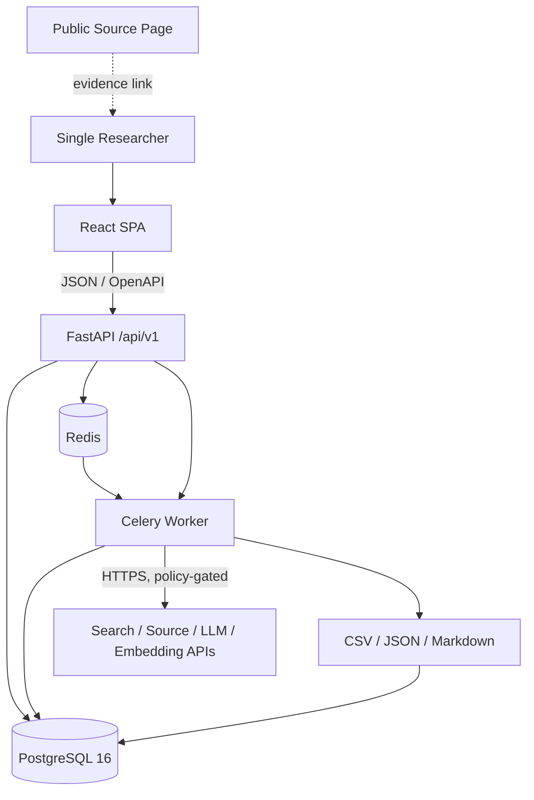
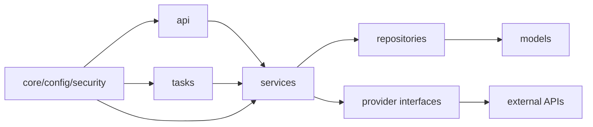
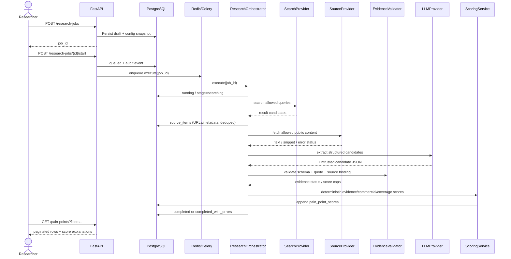
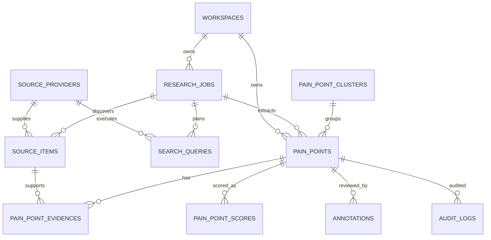
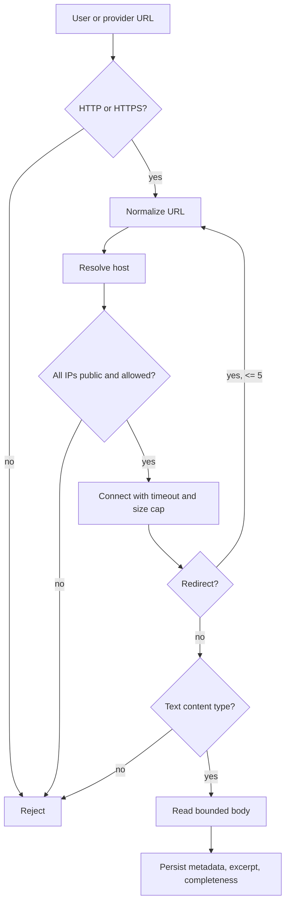

# Target Architecture

This document describes the implementation target. Phase 1 currently implements the local API, worker entrypoint, Mock evidence loop, React workbench, exports, and Compose configuration; real providers and multi-user authentication remain future work.

## System context



The researcher opens source evidence in a separate browser tab. The application never presents an LLM-generated URL as a source.

## Runtime components

| Component | Responsibility | Must not do |
|---|---|---|
| `web` | Research workflow, evidence inspection, review actions, export center | Hold provider secrets; calculate authoritative scores; bypass API pagination |
| `api` | Authentication boundary (future), validation, CRUD, job controls, health, OpenAPI | Execute long-running research synchronously; import vendor SDKs directly |
| `worker` | Query/search/fetch/extract/validate/dedupe/cluster/score/export stages | Own unrelated business logic divergent from API; use Redis as source of truth |
| `scheduler` | Optional periodic jobs; enabled only after Phase 4 acceptance | Run by default in Phase 0/1 |
| `postgres` | Durable jobs, sources, evidence, scores, annotations, audits, usage | Store unvalidated LLM output as verified facts |
| `redis` | Celery broker/result transport and rate-limit counters | Store the only copy of evidence or task progress |
| Providers | External search, source metadata/content, LLM, embeddings | Decide final evidence status or persist directly to business tables |

## Backend module boundaries

```text
backend/app/
  api/v1/            HTTP schemas, dependencies, route handlers
  core/              settings, logging, errors, security primitives, rate limits
  db/                engine, session factory, base types, migration support
  models/            SQLAlchemy persisted entities and constraints
  repositories/      query construction and persistence; no external HTTP
  services/          domain transactions and orchestration
  providers/         external adapter interfaces and implementations
  tasks/             thin Celery entrypoints delegating to services
  prompts/           versioned prompt templates
  utils/             normalization, hashing, URL/text helpers
```

Dependency direction:



Providers do not import API modules. Repositories do not call external services. Routes do not contain arithmetic for evidence or opportunity scores.

## Research pipeline



### Stage contract

Each stage receives a persisted job and stage context, performs bounded work, and writes a stage result. It must be safe to retry.

1. `query_planning`: generate or validate queries; enforce query/source/cost limits; persist each query.
2. `searching`: call allowed search providers; persist source candidates and provider usage.
3. `fetching`: perform policy-gated content retrieval with SSRF checks; preserve URL status and completeness.
4. `normalizing`: canonicalize URLs/text/metadata; compute content hashes; dedupe source records.
5. `extracting`: call the LLM adapter with untrusted source content; reject malformed output.
6. `validating_evidence`: bind program-owned source IDs/URLs; verify quotes/offsets; apply evidence caps/status downgrade.
7. `deduplicating`: identify content duplicates and candidate merge groups without deleting sources.
8. `clustering`: group related pain points; preserve every member and source link.
9. `scoring`: calculate evidence, commercial, and coverage scores with versioned details.
10. `completed`: finalize counts, cost, status, and audit summary.

### Idempotency and recovery

- Job controls use conditional database updates: start accepts only `draft`/`failed`, resume only `paused`, and retry only `failed`/`completed_with_errors`; invalid or duplicate requests return `409 CONFLICT`.
- The worker performs an atomic `queued -> running` claim. Duplicate broker deliveries, paused jobs, cancelled jobs, and terminal jobs return without starting another pipeline run.
- The pipeline re-reads status before finalization and failure handling; a concurrent pause or cancel is never overwritten by a later completion update.
- A stage records its input count, output count, attempt, and completion marker.
- Unique keys prevent duplicate source/evidence writes.
- A retry currently reopens failed work through the same durable-state boundary; resuming from fine-grained incomplete stages remains future work.
- A process restart must mark an orphaned `running` job as resumable or interrupted; automatic orphan recovery is not yet implemented.
- Exported files are content-addressed or versioned and can be regenerated.

## Provider interfaces

```python
class SearchProvider(Protocol):
    code: str
    capabilities: ProviderCapabilities

    async def search(self, request: SearchRequest) -> list[SearchResult]: ...


class SourceProvider(Protocol):
    code: str
    capabilities: ProviderCapabilities

    async def fetch(self, target: SourceTarget) -> SourceContent | SourceFailure: ...


class LLMProvider(Protocol):
    code: str

    async def extract_candidates(self, request: ExtractionRequest) -> ExtractionResponse: ...
    async def suggest_queries(self, request: QueryPlanningRequest) -> QuerySuggestionResponse: ...


class EmbeddingProvider(Protocol):
    code: str

    async def embed(self, texts: list[str]) -> list[list[float]]: ...
```

Concrete contracts may vary, but they must preserve these boundaries:

- Requests contain explicit limits, locale, time range, and policy context.
- Responses carry provider status, latency, retry metadata, and safe error categories.
- Provider models do not leak into persistence schemas.
- Secrets are resolved inside adapters from settings/secret references and are never serialized.

## Data model



Core constraints:

- UUID primary keys and UTC timestamps on all mutable entities.
- Source identity uses provider/external ID when available, otherwise canonical URL plus content hash rules.
- Evidence uniqueness is enforced by pain point, source item, and normalized quote.
- Scores are append-only history, not overwritten columns alone.
- Deleting a pain point never cascades into deleting original sources.
- Core filter fields are indexed; JSONB is reserved for genuinely variable detail.

## API surface

All application APIs use `/api/v1`. Errors use a stable envelope with `code`, `message`, `details`, and `request_id`.

```text
GET    /health
GET    /api/v1/settings/providers
PATCH  /api/v1/settings/providers/{provider_code}

POST   /api/v1/research-jobs
GET    /api/v1/research-jobs
GET    /api/v1/research-jobs/{id}
POST   /api/v1/research-jobs/{id}/start
POST   /api/v1/research-jobs/{id}/pause
POST   /api/v1/research-jobs/{id}/resume
POST   /api/v1/research-jobs/{id}/cancel
POST   /api/v1/research-jobs/{id}/retry-failed
GET    /api/v1/research-jobs/{id}/logs

GET    /api/v1/source-items
POST   /api/v1/source-items/import-url
POST   /api/v1/source-items/{id}/recheck-url

GET    /api/v1/pain-points
GET    /api/v1/pain-points/{id}
PATCH  /api/v1/pain-points/{id}
POST   /api/v1/pain-points/{id}/verify
POST   /api/v1/pain-points/{id}/reject
POST   /api/v1/pain-points/{id}/merge
POST   /api/v1/pain-points/{id}/rescore
POST   /api/v1/pain-points/{id}/annotations

GET    /api/v1/clusters
GET    /api/v1/clusters/{id}
GET    /api/v1/taxonomy/categories
POST   /api/v1/exports/pain-points
GET    /api/v1/exports/{id}
```

The final route list is generated from runtime code and published in OpenAPI. This list is the contract target, not evidence that routes already exist.

## Frontend structure

```text
frontend/src/
  app/            router, query client, providers, layout
  api/            generated OpenAPI types and typed fetch client
  components/     shared accessible UI primitives
  features/
    dashboard/
    research-jobs/
    pain-points/
    evidence/
    source-browser/
    clusters/
    taxonomy/
    settings/
    exports/
  lib/            formatting, validation adapters, feature flags
  types/          client-only view types
  styles/         Tailwind entry and design tokens
```

The core pain-point workspace uses three regions: filters, server-paginated table, and evidence detail. Evidence URLs, publication time, collection time, quote-match status, score version, and score dimensions are first-class fields.

## SSRF-safe fetch flow



Every redirect is a fresh validation boundary. DNS is checked both before and after resolution to reduce rebinding risk. The fetcher does not execute JavaScript, follow non-HTTP schemes, download files, or expose raw provider errors.

## Observability

- Structured logs include `request_id`, `job_id`, stage, provider, duration, item counts, retry count, and safe error category.
- Metrics include provider requests, 401/403/429/timeouts, LLM schema rejection rate, evidence quote match rate, score latency, and job stage duration.
- Never log full page content, cookies, authorization headers, complete request bodies, or API keys.
- `/health` reports database and Redis connectivity; provider-specific health is separate and does not make the whole API unhealthy.
- Audit events cover status changes, merges, score corrections, provider configuration changes, and job controls.

## Failure semantics

| Failure | Required behavior |
|---|---|
| One provider returns 401/403 | Mark provider blocked/degraded, stop retrying, preserve other providers' results |
| Provider returns 429 | Honor Retry-After, bounded backoff, then pause relevant stage if needed |
| Fetch timeout | Record `timeout`, keep search metadata, continue with other sources |
| LLM returns invalid JSON/schema | Reject output, log safe category, retry within limit, never persist as verified |
| Quote not found | Downgrade evidence, cap score, mark review required |
| Budget exhausted | Pause job, persist consumed estimate, make resume explicit |
| Worker dies | Recover from durable stage progress; avoid duplicate writes |
| Frontend request fails | Show retryable error; do not fabricate cached source links or scores |

## Deployment target

```text
docker compose:
  web        React static build served by a small web server
  api        FastAPI + Uvicorn
  worker     Celery worker
  scheduler  Celery beat, optional
  postgres   PostgreSQL 16
  redis      Redis 7
```

The local demo must start without a search, LLM, or embedding API key. The API and worker share configuration and domain code through the backend image. In the single-replica local Compose stack the API container runs `alembic upgrade head` once before Uvicorn starts; multi-replica or production deployment must move migrations to an explicit release job. Compose publishes only loopback ports and the API has no authentication, so the stack is local-only.

## Architecture change protocol

Any change to a trust boundary, provider interface, job state machine, evidence constraint, or score formula requires a graph event and an entry in the technical selection or evidence document. Preserve superseded decisions instead of rewriting history.
