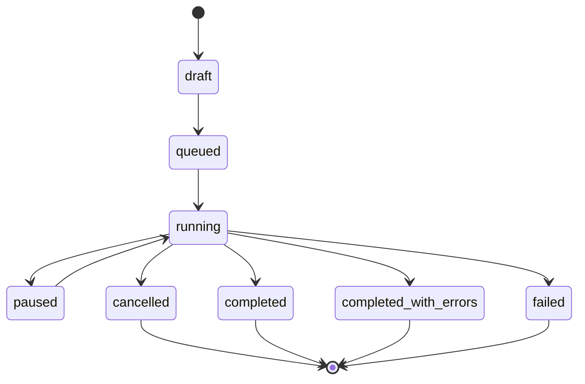

# Requirements Analysis

## Executive summary

The specification describes a local-first research application, not a generic crawler or an idea generator. Its central product contract is a traceable evidence chain:

`research job -> query -> source item -> evidence quote -> pain point -> score -> human verification -> export`

Every downstream feature must preserve that chain. The MVP is successful only when a user can run an offline Mock job, inspect each candidate's evidence and score explanation, open the original source URL, and export the same evidence without data loss.

The specification is 1633 lines across 26 sections. It explicitly asks for staged delivery, with Phase 1 as the highest priority. The repository was empty except for `README.md` and `LICENSE`, so there is no legacy stack to preserve.

## Product boundary

### Included in the MVP

- Single-user workspace with future `workspace_id` / `user_id` extension points.
- A four-step research job wizard with hard limits on queries, results, sources, time, and estimated cost.
- Mock search, manual URL import, Mock LLM, and an optional OpenAI-compatible LLM.
- Source persistence, content completeness labels, evidence quote validation, and source deduplication.
- Deterministic evidence, commercial opportunity, and coverage scores with persisted score history.
- A pain-point workbench with server-side filtering, sorting, pagination, verification, rejection, and merge.
- CSV, JSON, and Markdown export with source URLs and evidence snippets.
- Offline demo data and a complete Mock integration test.

### Explicitly out of scope for the MVP

- Autonomous business decisions or claims that a score proves a market.
- Crawling login-only content, private groups, paywalls, captchas, or access-controlled pages.
- Bypassing rate limits, rotating identities, or using account pools.
- Training foundation models on collected content.
- A general-purpose crawler, CRM, search engine, or microservice platform.
- Kubernetes, multi-region deployment, billing, and team permissions.

## Hard constraints and engineering implications

| Constraint | Engineering implication |
|---|---|
| A fact-level pain point requires at least one evidence record | Enforce at service and database levels; never rely on UI convention |
| Source URLs cannot be generated by an LLM | Copy URLs only from persisted `SourceItem`; reject model-supplied URL fields |
| Evidence quotes must be verifiable | Store normalized quotes and offsets; validate against fetched text or mark `snippet_only` / `not_found` |
| Evidence and commercial scores are separate | Use separate score types, histories, sort keys, and UI quadrants; never sum them |
| Human review is mandatory before `verified` | Store actor, reason, and before/after state in `audit_logs` |
| Every provider can fail independently | Isolate adapters, record health/usage, and allow `completed_with_errors` |
| Unbounded jobs are forbidden | Enforce task, provider, and system limits; pause safely when cost or time limits are reached |
| Web content is hostile input | Treat pages as data; disable tool execution; defend against prompt injection |
| URL fetching is an SSRF boundary | Validate scheme, DNS, IP ranges, redirects, ports, response size, content type, and timeouts |
| All secrets remain server-side | Environment/secret references only; redact logs; never return keys to the browser |
| All lists are server-paginated | Cursor/offset pagination in repositories; no full-table response |
| No API key may be required for the demo | Mock search/source/LLM/embedding providers are defaults |
| A failed fetch is not proof of a fake source | Persist explicit URL status and distinguish temporary failures from invalid evidence |
| Deduplication must not destroy evidence | Preserve aliases, original URLs, source links, and merge redirects |
| CSV can execute formulas | Prefix dangerous leading characters and test the sanitizer |

## Priority requirements

### P0: correctness and evidence integrity

1. Database constraints for sources, evidence uniqueness, score ranges, UUIDs, and foreign-key behavior.
2. Deterministic URL normalization, URL validation, quote matching, source deduplication, and independent-source counting.
3. Evidence and commercial scoring formulas with versioned, append-only score records.
4. Job state machine, stage transitions, idempotency, and audit events.
5. SSRF protection, secret redaction, prompt-injection boundaries, and safe export.
6. Offline Mock path from job creation through export.

### P1: usable research workflow

1. Research job wizard, progress view, provider health, and pause/resume/cancel controls.
2. Pain-point workbench and detail panel with first-class evidence links.
3. Manual review, rejection, merge, annotations, and next validation action.
4. Source browser, saved filters, coverage warnings, and score explanations.
5. CSV, JSON, and Markdown export.

### P2: additional sources and research depth

1. GitHub Issues/Discussions provider, then one configurable search API, then Hacker News.
2. Reddit only after explicit policy confirmation and authorized credentials.
3. Optional embeddings and semantic clustering with rule-based fallback.
4. Competitor research, root-cause hypotheses, interview guides, and coverage scoring.

## Domain lifecycle

Pain point states are `candidate -> needs_review -> verified` for the success path, with `hypothesis`, `rejected`, `duplicate`, and `archived` as controlled alternatives. Every transition needs an audit record; only human or explicitly labeled system review can produce `verified`.

Research stages are:

`query_planning -> searching -> fetching -> normalizing -> extracting -> validating_evidence -> deduplicating -> clustering -> scoring -> completed`.

Each stage records start/end time, counts, retries, duration, errors, and cost estimate where available.

## Decisions and assumptions

| Topic | Decision |
|---|---|
| Deployment | Local Docker Compose modular monolith; no microservices or Kubernetes |
| Backend concurrency | FastAPI with synchronous SQLAlchemy sessions for the MVP; Celery for background work |
| Queue | Celery only; Redis is broker/result backend, not the business database |
| Data truth | PostgreSQL stores sources, job progress, evidence, scores, audits, and provider usage |
| Frontend state | TanStack Query for server state; local component state only for presentation |
| Forms | React Hook Form + Zod; one shared schema shape with the API contract where practical |
| UI system | Tailwind CSS + shadcn/ui; no second component framework |
| Text similarity | Rule/normalization first, PostgreSQL text similarity second, optional embeddings third |
| LLM output | OpenAI-compatible adapter + strict Pydantic validation; Mock default |
| Database timezone | Store UTC; default workspace display timezone is `Asia/Shanghai`, configurable per workspace |
| Money | `Decimal` plus explicit currency/estimate metadata; no float arithmetic |
| Content retention | Default short excerpts + metadata; full text only when source policy and user settings allow |
| Real providers | GitHub first, then one search API, then Hacker News; Reddit remains opt-in and policy-gated |
| Auth | Single-user local MVP; workspace/user identifiers reserved in the schema and service interfaces |

The workspace timezone differs from the sample value in the source document (`Asia/Tokyo`). This is a product-default decision for the current user and remains configurable; it does not alter storage semantics.

## Key risks and mitigations

| Risk | Impact | Mitigation |
|---|---|---|
| Model fabricates a quote or URL | Invalid conclusions, trust failure | Program-supplied URLs; exact/normalized quote matching; schema rejection; manual review |
| SSRF through manual import or redirects | Internal network or metadata exposure | Pre/post-DNS IP checks, redirect revalidation, port allowlist, size and type caps |
| Prompt injection in source text | Secret leakage or unsafe tool use | Treat content as data, least-privilege model, no arbitrary tools, constrained structured output |
| Duplicate content inflates confidence | False evidence strength | Provider ID / canonical URL / content hash dedupe; thread and author independence keys |
| Provider outage or rate limit | Stalled research | Adapter isolation, health states, Retry-After, bounded exponential backoff, partial completion |
| Cost overrun | Unexpected charges | Job/provider/system budgets, estimated cost records, pause on limit |
| Clustering hides sources | Evidence loss | Cluster is a view; preserve every pain point/source link and merge redirect |
| CSV formula injection | Local or spreadsheet compromise | Escape formula-leading cells and test export fixtures |
| Score appears authoritative | Misleading business decision | Separate scores, explanation panel, coverage warning, prohibited marketing copy |
| Background task duplication | Duplicate sources or scores | Idempotency keys, unique constraints, resumable stage state |

## Traceability matrix

| Spec section | Concern | Primary implementation owner |
|---|---|---|
| 0 | Execution and delivery rules | `AGENTS.md`, development workflow |
| 1-3 | Product scope, workflow, state machine, taxonomy | Domain models, services, taxonomy tables |
| 4 | Source access policy | Provider contracts, settings, policy confirmation UI |
| 5 | Evidence hard constraints | `source_items`, `pain_point_evidences`, evidence validator |
| 6 | Research jobs and limits | Job orchestrator, Celery tasks, usage records |
| 7 | Query planning and filtering | Query planner, search provider adapters |
| 8 | Candidate extraction and prompt defense | Extractor, prompts, Pydantic schemas |
| 9 | Deduplication and clustering | Dedupe service, clustering service, optional embeddings |
| 10 | Evidence/commercial/coverage scores | Scoring services, score history, sort policies |
| 11 | Competitor and root-cause research | Annotations, research fields, interview guide |
| 12-13 | Stack and directory structure | Technical decision records, project scaffold |
| 14 | Core tables and constraints | SQLAlchemy models, Alembic migrations |
| 15 | API contract | FastAPI routers and schemas |
| 16 | UI and interaction | React features and shared UI primitives |
| 17 | Exports | Export service and sanitizer |
| 18 | Security, privacy, source terms | SSRF guard, settings, logging, retention policy |
| 19 | Test matrix | pytest, integration fixtures, Vitest, Playwright |
| 20 | Non-functional targets | Indexes, pagination, asynchronous jobs, health checks |
| 21 | Environment configuration | `.env.example`, Pydantic settings |
| 22-24 | Phased delivery and acceptance | `docs/knowledge-graph` phases and acceptance nodes |
| 25-26 | Copy and product principles | UI copy constants and review checklist |

## Delivery sequence

1. Phase 0: repository baseline, Compose, FastAPI health, React shell, PostgreSQL/Redis, migrations, Mock provider, smoke test.
2. Phase 1: offline evidence-driven research loop and workbench.
3. Phase 2: real providers with policy, rate-limit, retry, and health controls.
4. Phase 3: clustering, taxonomy management, review audit, and saved views.
5. Phase 4: commercial research, interviews, coverage, and report exports.
6. Phase 5: optional scheduling and trend features only after prior phases pass acceptance.

Each phase ends with the commands actually run, test results, known limitations, and a new knowledge-graph event.
